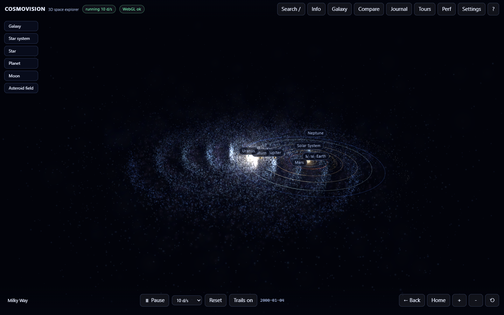
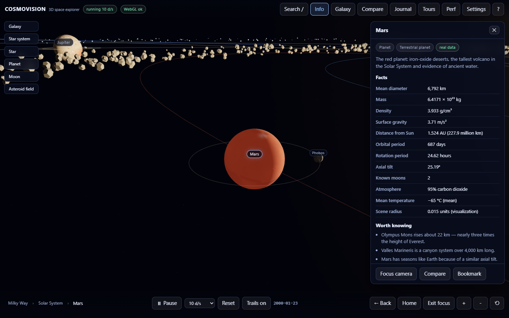

# CosmoVision

**Interactive 3D space exploration platform** — fly from a procedural Milky Way
into a living Solar System, with NASA-sourced facts on every body you select.



## What it is

- **One continuous scene** — a seeded four-arm spiral galaxy (~42,000 GPU
  particles) with the Solar System embedded in the disc. Zoom in and the galaxy
  fades as planets, moons and asteroid belts take over.
- **Source-backed data** — 17 objects (galaxy, system, Sun, 8 planets, 5 moons,
  2 belts). Every fact is tagged `measured`, `approximate`, `illustrative` or
  `procedural` and cites NASA / IAU sources. No AI-generated numbers.
- **Simulation clock** — deterministic orbital animation at 0.1–1000 simulated
  days per second, with orbit trails and a J2000-based date readout.
- **Exploration tools** — fuzzy search, guided Discovery tours, breadcrumbs +
  history (Back/Home), object comparison with charts, a personal journal with
  bookmarks and notes (saved locally), and a full galaxy parameter explorer.



## Quick start

```bash
npm install
npm run dev        # http://localhost:4173
```

Production build and checks:

```bash
npm run typecheck        # tsc --noEmit (strict)
npm test                 # Vitest unit suite (77 tests)
npm run build            # vite build → dist/
npm run test:e2e         # Puppeteer smoke test + screenshots (needs Chrome/Edge)
npm run verify           # typecheck + test + build
```

The e2e test uses your system Chrome or Edge (override with
`COSMOVISION_CHROME=/path/to/chrome`) and renders via SwiftShader, so it works
without a GPU.

## Controls

Drag to orbit, wheel to zoom, click to select, double-click to focus. Keyboard:
`/` search · `Space` pause · `Esc` back out · `Home` galaxy view · `Backspace`
history · `?` full help. See [docs/CONTROLS.md](docs/CONTROLS.md).

## How it stays honest

Orbit radii and periods are **compressed** (documented exponent, order and
rhythm preserved) so every planet is watchable at once; surfaces and the galaxy
are procedural illustrations. Science mode labels each fact's precision and
shows its source. Details in [docs/SCIENCE.md](docs/SCIENCE.md).

## Stack

React 19 · TypeScript (strict) · Vite 8 · Three.js + React Three Fiber + Drei ·
Zustand · Recharts · Vitest · Puppeteer. Architecture notes:
[docs/ARCHITECTURE.md](docs/ARCHITECTURE.md).

## Project layout

```
src/scene      WebGL layer (galaxy, solar system, camera rig, shaders)
src/data       Object catalogue, sources, tours, galaxy presets
src/store      Single Zustand store + localStorage persistence
src/ui         HUD panels, search, help, top/bottom bars
src/lib        Pure math/search/format helpers (unit-tested)
tests/         Vitest unit tests + Puppeteer e2e
docs/          Science notes, architecture, controls
```

## Browser support

Evergreen Chrome/Edge/Firefox/Safari with WebGL. If WebGL cannot start, the app
degrades to an accessible data view with the same facts and sources.
